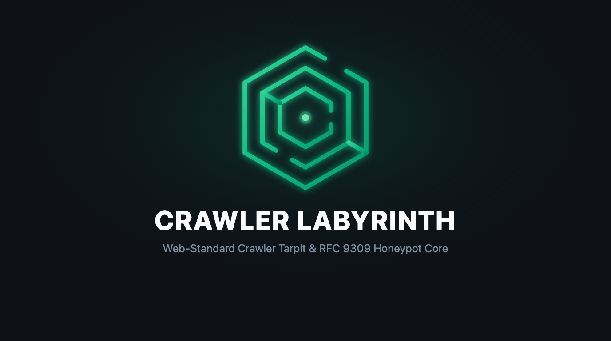
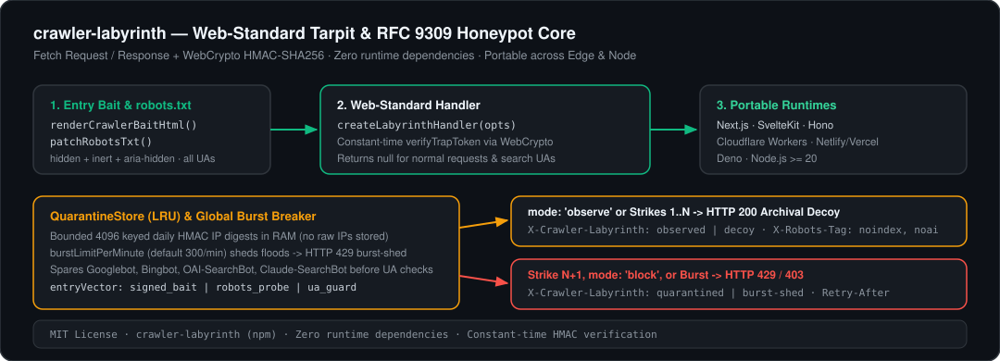

<p align="center">
  
</p>

<h1 align="center">Crawler Labyrinth</h1>

<p align="center">
  <strong>Zero-dependency Web-standard crawler tarpit, accessible-inert honeypot HTML helper, and RFC 9309 <code>robots.txt</code> patcher for Next.js, SvelteKit, Hono, Cloudflare Workers, Deno, and Node.</strong>
</p>

<p align="center">
  <a href="https://github.com/arnoldwender/crawler-labyrinth-js/actions/workflows/ci.yml"></a>
  <a href="LICENSE"></a>
  = 20.0.0" />
  
  
</p>

| Field | Value |
| --- | --- |
| **Author** | [Arnold Wender](https://arnoldwender.com) |
| **Repository** | [github.com/arnoldwender/crawler-labyrinth-js](https://github.com/arnoldwender/crawler-labyrinth-js) |
| **Companion Astro Integration** | [arnoldwender/astro-crawler-labyrinth](https://github.com/arnoldwender/astro-crawler-labyrinth) (`astro-crawler-labyrinth` on npm) |
| **Companion WordPress Plugin** | [arnoldwender/crawler-labyrinth](https://github.com/arnoldwender/crawler-labyrinth) (`GPLv2+`) |
| **Runtime Support** | Web Standards (`Request` / `Response`, `WebCrypto`) · Node `>= 20.0.0` · Deno · Cloudflare Workers · Vercel/Netlify Edge |
| **License** | [MIT License](LICENSE) |
| **Built with an agentic workflow** | Developed with AI coding agents. Review and test it like any third-party code before you use it in production. |
| **Support & Liability** | **Zero support** — reproducible bugs on [GitHub Issues](https://github.com/arnoldwender/crawler-labyrinth-js/issues) only · **no private support** · **AS IS / no liability** ([SUPPORT.md](SUPPORT.md)) |
| **Verification** | `npm run typecheck && npm run build && npm test && npm run test:mutations && npm pack --dry-run` |

---

## Why This Exists

`robots.txt` is a request, not a lock: RFC 9309 explicitly states that its rules "are not a form of access authorization". `crawler-labyrinth` provides a framework-agnostic, deterministic tarpit built purely on Web Standards (`Request`, `Response`, `URL`, `Headers`, and `globalThis.crypto.subtle`)—zero npm runtime dependencies, zero outbound SaaS proxy calls, and zero raw IP storage.

1. **Accessible-Inert Entry Bait (`renderCrawlerBaitHtml` / `buildBaitLinks`):** Emits a native `<div hidden inert aria-hidden="true" data-crawler-labyrinth="1">` link carrying `tabindex="-1"` and `rel="nofollow noopener"` pointing to `/${routePrefix}/<signed-token>/`.
2. **RFC 9309 Multi-Group `robots.txt` Patching (`patchRobotsTxt`):** Injects `Disallow: /${routePrefix}/` into **every** `User-agent:` group so named blocks like `OAI-SearchBot` or `PerplexityBot` with `Allow: /` cannot shadow the disallow rule.
3. **Deterministic Local Labyrinth, Dry-Run & Quarantine (`createLabyrinthHandler`):**
   - `hybrid` (default): serves deterministic `noindex, nofollow, noarchive, nosnippet, noai, noimageai` archival decoys (`X-Crawler-Labyrinth: decoy`) up to `strikeThreshold`, then quarantines the daily keyed IP digest with HTTP `429` (`Retry-After`) or `403` (`X-Crawler-Labyrinth: quarantined`).
   - `observe`: dry-run mode serving decoys (`X-Crawler-Labyrinth: observed`) and emitting `'observed'` telemetry events with `entryVector` (`signed_bait`, `robots_probe`, `ua_guard`) without issuing `429`/`403` blocks.
   - `labyrinth`: continues serving ring-bounded decoys indefinitely.
   - `block`: quarantines immediately on strike `1`.
4. **Global Burst Circuit Breaker (`burstLimitPerMinute`):** Protects SSR/Edge instances from multi-IP floods by shedding excess requests per 60-second UTC window with HTTP `429` (`Retry-After: 60`, `X-Crawler-Labyrinth: burst-shed`, `actionTaken: 'burst_shed'`) without expanding `QuarantineStore`.

---

## Architecture

<p align="center">
  
</p>

---

## Quick Start

```bash
npm install crawler-labyrinth
```

### Next.js (`middleware.ts` + Footer Bait)

```ts
// middleware.ts
import { NextResponse, type NextRequest } from 'next/server';
import { createLabyrinthHandler } from 'crawler-labyrinth';

const labyrinth = createLabyrinthHandler({
  routePrefix: 'crawler-trap',
  mode: 'hybrid',
  strikeThreshold: 5,
  burstLimitPerMinute: 300,
  secret: process.env.CRAWLER_LABYRINTH_SECRET,
});

export async function middleware(request: NextRequest) {
  const res = await labyrinth(request, request.ip);
  if (res) {
    return res;
  }
  return NextResponse.next();
}
```

Render the matching signed entry links in a layout or server component using `buildBaitLinks()` or `renderCrawlerBaitHtml()`.

### SvelteKit (`src/hooks.server.ts`)

```ts
import type { Handle } from '@sveltejs/kit';
import { createLabyrinthHandler } from 'crawler-labyrinth';

const labyrinth = createLabyrinthHandler({
  secret: process.env.CRAWLER_LABYRINTH_SECRET,
});

export const handle: Handle = async ({ event, resolve }) => {
  const res = await labyrinth(event.request, event.getClientAddress());
  if (res) {
    return res;
  }
  return resolve(event);
};
```

### Hono / Cloudflare Workers / Deno

```ts
import { Hono } from 'hono';
import { createLabyrinthHandler } from 'crawler-labyrinth/edge';

const app = new Hono();
const labyrinth = createLabyrinthHandler({
  mode: 'hybrid',
  trustProxyHeaders: true,
  secret: globalThis.process?.env?.CRAWLER_LABYRINTH_SECRET,
});

app.use('*', async (c, next) => {
  const res = await labyrinth(c.req.raw);
  if (res) {
    return res;
  }
  return next();
});
```

---

## API & Configuration Reference (`EdgeLabyrinthOptions`)

| Option | Type | Default | Constraints & Behavior |
| :--- | :--- | :--- | :--- |
| `routePrefix` | `string` | `'crawler-trap'` | 3–32 chars (`[a-z0-9_-]`); reserved stems (`_next`, `_astro`, `_assets`, `api`, `media`, `well-known`, `robots`, `sitemap`, `favicon`, `admin`) fall back to `'crawler-trap'`. |
| `basePath` | `string` | `''` | Optional subpath mount prefix (e.g. `'/docs'`). |
| `trailingSlash` | `'always' \| 'never' \| 'ignore'` | `'always'` | Controls trailing slashes on generated decoy and bait URLs. |
| `mode` | `'hybrid' \| 'labyrinth' \| 'block' \| 'observe'` | `'hybrid'` | Enforcement mode (`observe` runs dry-run telemetry without quarantining). |
| `format` | `'html' \| 'plain'` | `'html'` | Response body format for decoys (`HTML5` or `text/plain`). |
| `secret` | `string` | `DEFAULT_SECRET` | Minimum 16 characters required; set a unique secret in production. |
| `maxDepth` | `number` | `8` | Clamped to `1..16`; ring links wrap back to depth `1`. |
| `linkCount` | `number` | `1` | Clamped to `1..5`; number of links emitted by `buildBaitLinks` / `renderCrawlerBaitHtml`. |
| `strikeThreshold` | `number` | `5` | Clamped to `1..100`; decoys served before quarantine in `hybrid` mode. |
| `blockTtlMs` | `number` | `21600000` (6h) | Clamped to `60_000..604_800_000` (1m to 7d). Sets `Retry-After` on HTTP `429`. |
| `blockStatus` | `429 \| 403` | `429` | HTTP status code sent during quarantine (`X-Crawler-Labyrinth: quarantined`). |
| `burstLimitPerMinute` | `number` | `300` | Global trap hits per 60 s UTC bucket before shedding flood traffic with `429` (`X-Crawler-Labyrinth: burst-shed`, `Retry-After: 60`); `0` disables, otherwise clamped `5..10_000`. |
| `interceptTrainingBots` | `boolean` | `false` | Opt-in UA matching for training scrapers (`GPTBot`, `CCBot`, `ClaudeBot`, `Bytespider`, `Scrapy`, etc.) while strictly sparing search/citation bots first. |
| `trustProxyHeaders` | `boolean` | `false` | Opt-in to read proxy IP headers when `clientIp` is omitted. Without `trustedProxyHeader`, inspects `cf-connecting-ip`, `x-nf-client-connection-ip`, `x-real-ip`, `x-forwarded-for` in order — leave `false` or pin `trustedProxyHeader` behind multi-CDN proxies that strip only their own header. |
| `trustedProxyHeader` | `string \| undefined` | `undefined` | When `trustProxyHeaders: true`, restricts extraction strictly to a single validated lowercase header name (e.g. `'x-nf-client-connection-ip'` or `'cf-connecting-ip'`) so sibling CDN headers cannot be spoofed to bypass bans. |
| `excludedPrefixes` | `readonly string[]` | `DEFAULT_EXCLUDED_PREFIXES` | Path prefixes bypassed on normal requests (`/_next`, `/_astro`, `/api`, `/robots.txt`, `/sitemap`, `/favicon`, etc.). |
| `entrySeed` | `string` | `'archroot0001'` | Sanitized alphanumeric seed (`4..24` chars) for deterministic entry links. |
| `onViolation` | `(event: TrapViolationEvent) => void \| Promise<void>` | `undefined` | Optional telemetry callback receiving masked `ipDigest`, `actionTaken`, and `entryVector`. |

---

## Development & Verification

```bash
npm install
npm run typecheck
npm run build
npm test
npm run test:mutations
npm pack --dry-run
```

---

## Support, Bug Reports & Zero Liability

> **Zero Support & Use at Your Own Risk:** See [SUPPORT.md](SUPPORT.md).

- **Zero support:** Published as-is with **zero technical, setup, deployment, or user support**, and zero response SLA.
- **GitHub Issues only:** Report reproducible software defects **exclusively** via [GitHub Issues](https://github.com/arnoldwender/crawler-labyrinth-js/issues) (or [GitHub Security Advisories](https://github.com/arnoldwender/crawler-labyrinth-js/security/advisories/new)).
- **No private support:** **Do not** send private support requests via email, `arnoldwender.com`, or direct messages.
- **Zero responsibility & no warranty ("AS IS"):** Provided **"AS IS"** under the [MIT License](LICENSE) without warranty or author liability.

## License

Licensed under the [MIT License](LICENSE).
